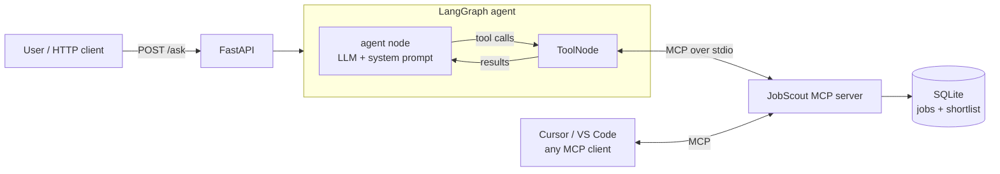

# JobScout MCP 🔎

**An MCP (Model Context Protocol) server plus a LangGraph agent that analyses the AI/ML job market.**

Ask it things like *"I have 2 years of experience with Python, RAG and LangChain. Which Pune or remote GenAI jobs fit me best, and what should I learn next?"*. The agent then:

1. discovers the tools exposed by the MCP server at runtime,
2. searches jobs, ranks the most requested skills and computes your skill gap per job,
3. shortlists the best match and answers with grounded, specific next steps.

[](https://github.com/RB6339/jobscout-mcp/actions)
  

> Demo video: _add your 2-minute Loom link here_

---

## Architecture



**Why MCP?** The agent never imports the data layer. Every capability is discovered from the MCP server at runtime, so:

- the same server works with **Cursor, VS Code or any MCP client**, with zero code changes;
- the agent can be pointed at **any other MCP server** (GitHub, Postgres, Slack) without changing the graph.

## MCP surface

| Type | Name | What it does |
|---|---|---|
| Tool | `search_jobs` | Filter by keywords, city, years of experience, remote |
| Tool | `get_job` | Full posting details |
| Tool | `skill_demand` | Rank the most requested skills (count and share) for a query or city |
| Tool | `skill_gap` | Match score plus matched and missing skills for *your* skill list against a job |
| Tool | `add_to_shortlist` / `list_shortlist` | Write tools that persist state, to show side-effectful tool use |
| Resource | `jobscout://stats` | Market stats by city and title, average salary |
| Prompt | `career_advisor` | Reusable prompt template for an end-to-end career review |

## Quickstart

```bash
git clone https://github.com/RB6339/jobscout-mcp && cd jobscout-mcp
python -m venv .venv && source .venv/bin/activate      # Windows: .venv\Scripts\activate
pip install -e ".[dev]"
cp .env.example .env    # add OPENAI_API_KEY (or any OpenAI-compatible endpoint)
```

### 1. Ask the agent from the terminal

```bash
export $(cat .env | xargs)   # or set the variables manually
jobscout --trace "I know python, rag, langchain and fastapi with 2 years experience. \
Which Pune or remote GenAI jobs fit me best? Shortlist the top one."
```

`--trace` prints every MCP tool call the agent made, which is useful for demos and debugging.

### 2. Run the HTTP API

```bash
uvicorn jobscout.api:app --port 8080
# open http://localhost:8080/docs for interactive Swagger docs
curl -X POST localhost:8080/ask -H "content-type: application/json" \
  -d '{"question": "Top 5 skills for AI engineer jobs in Bengaluru?"}'
```

### 3. Use the MCP server from any MCP client (Cursor, VS Code, ...)

Add this to your client's MCP config (for Cursor: `~/.cursor/mcp.json`), then restart the client:

```json
{
  "mcpServers": {
    "jobscout": {
      "command": "/absolute/path/to/jobscout-mcp/.venv/bin/python",
      "args": ["-m", "jobscout.server"]
    }
  }
}
```

You can also inspect it with the official MCP Inspector: `npx @modelcontextprotocol/inspector python -m jobscout.server`

### 4. Docker

```bash
docker build -t jobscout-mcp .
docker run -p 8080:8080 --env-file .env jobscout-mcp
```

## Tests

```bash
pytest -q        # 13 tests, no API key needed
ruff check .
```

The test suite covers three layers:

- **Data layer**: search, experience filtering, skill aliases ("Model Context Protocol" → `mcp`), gap scoring, shortlist upsert.
- **MCP protocol, end to end**: launches the real server over stdio, then discovers and calls tools and reads the resource exactly as an MCP client would.
- **Agent graph**: runs the full LangGraph loop against the real MCP server with a scripted offline model, so CI needs no API key.

## Project structure

```
src/jobscout/
  db.py        # SQLite data layer (pure Python, unit-tested)
  server.py    # MCP server: tools, resource, prompt (FastMCP)
  agent.py     # LangGraph StateGraph: agent <-> ToolNode loop, MCP tool discovery
  api.py       # FastAPI: /ask, /tools, /health
  cli.py       # `jobscout "question"` command
data/jobs_sample.json        # 60 synthetic postings (fictional companies)
scripts/generate_sample_data.py, scripts/import_csv.py
tests/                       # data, MCP protocol, agent graph and API tests
```

## Design decisions

- **Compact tool outputs.** `search_jobs` drops long descriptions, so results don't flood the LLM context. `get_job` fetches the details only when needed.
- **Skill normalisation.** Aliases are mapped to canonical names before counting or matching, so "LangChain" and "lang chain" don't split the statistics.
- **Grounding rules in the system prompt.** The agent must search before recommending and must never invent job ids or salaries.
- **Provider-agnostic.** The agent uses any OpenAI-compatible API via `OPENAI_BASE_URL` (OpenAI, Groq, OpenRouter, local Ollama).
- **Bounded loops.** A `recursion_limit` caps how many agent ↔ tool round-trips one request can make.

## Data

`data/jobs_sample.json` is **fully synthetic**: fictional companies, generated by `scripts/generate_sample_data.py` with a fixed seed. To analyse your own exported postings, run `python scripts/import_csv.py your_jobs.csv`.

## Roadmap

- [ ] Semantic job search with embeddings and pgvector
- [ ] Streamable-HTTP transport deployed on AWS (ECS/Lambda)
- [ ] Agent evaluation set (golden questions, with tool-call accuracy and answer grounding measured)
- [ ] Streamlit chat UI

## License

MIT
